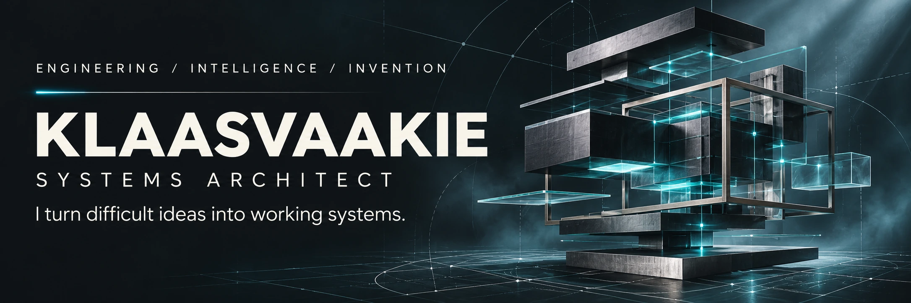

  

  <strong>SYSTEMS ENGINEERING &nbsp; / &nbsp; AI ARCHITECTURE &nbsp; / &nbsp; FULL-STACK DEVELOPMENT</strong>

<h1 align="center">I architect. I build. I ship.</h1>

  I'm <strong>Klaasvaakie</strong>, a systems engineer who works across architecture, code, and operations. 
  I turn complex requirements into software people can use, and systems people can reason about.

  <a href="#selected-work">Explore the work</a> &nbsp; · &nbsp;
  <a href="#how-i-build">How I build</a> &nbsp; · &nbsp;
  <a href="https://github.com/WimpyvL?tab=repositories">Browse repositories</a>

---

### From the interface to the infrastructure

<table>
<tr>
<td width="33%" valign="top">
<h3>01 / Intelligent systems</h3>

LLM integration, agent workflows, context engineering, and automation with clear boundaries and useful outcomes.

</td>
<td width="33%" valign="top">
<h3>02 / Complete products</h3>

Interfaces, APIs, identity, data models, and the operational workflows that make a product work beyond its demo.

</td>
<td width="33%" valign="top">
<h3>03 / Systems that hold</h3>

Cloud architecture, delivery pipelines, observability, recovery paths, and security built into the design.

</td>
</tr>
</table>

### Selected work

A few public repositories to explore across platforms, business software, and creative experiments.

<table>
<tr>
<td width="50%" valign="top">
<h3><a href="https://github.com/WimpyvL/idealtrue">Ideal Stay</a></h3>

Accommodation marketplace and host operations platform, spanning discovery, bookings, and administration.

React · TypeScript · Encore · PostgreSQL

</td>
<td width="50%" valign="top">
<h3><a href="https://github.com/WimpyvL/Zappy-Health-Dashboard">Telehealth Dashboard</a></h3>

A healthcare dashboard bringing patient, provider, and admin workflows into a shared application.

Next.js · TypeScript · Firebase

</td>
</tr>
<tr>
<td width="50%" valign="top">
<h3><a href="https://github.com/WimpyvL/topcut">Top Cut</a></h3>

A South African service-business website with responsive interfaces, service discovery, and quote requests.

Next.js · Tailwind CSS · Framer Motion

</td>
<td width="50%" valign="top">
<h3><a href="https://github.com/WimpyvL/Cosmic-shooter">Cosmic Shooter</a></h3>

A creative app experiment. A different corner of the workshop, where play gets room alongside practical systems.

React · Three.js · Prototype

</td>
</tr>
</table>

### How I build

- **Understand the whole system.** Follow the data, incentives, dependencies, and failure paths.
- **Make complexity earn its place.** Choose the smallest design that solves the real problem.
- **Keep intelligence accountable.** Give automation explicit permissions, observable actions, and recovery paths.
- **Finish the operational story.** Testing, deployment, monitoring, and rollback belong in the design.

### Tools of the trade

**Build** &nbsp; TypeScript · JavaScript · Python · React · Next.js · Node.js  
**Data & cloud** &nbsp; PostgreSQL · Supabase · Encore · Firebase · Docker · Vercel  
**Focus** &nbsp; AI systems · API integration · automation · platform architecture

---

  <strong>Bring a difficult problem. Let's make it work.</strong> 
  Engineering / Intelligence / Invention

